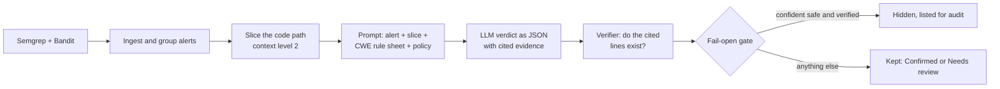

# SAST Triage

**Targeted LLM-assisted secure code review: fewer false alarms from static analysis, without hiding real bugs.**

[](https://github.com/zainab-nooh/llm-sast-triage/actions/workflows/tests.yml)
[](https://github.com/zainab-nooh/llm-sast-triage/actions/workflows/sast-triage.yml)

Static analysis tools (SAST) such as Semgrep and Bandit find real vulnerabilities, but about half of what they report
is noise. Developers learn to ignore the alerts, and real bugs get ignored with them. SAST Triage runs the scanners,
gives an LLM a small, targeted view of each alert (the code path that matters, plus a rule sheet for that weakness
type), and hides an alert **only** when the model is confident it is safe **and** its cited evidence checks out.
Everything else is kept for a person. If anything goes wrong, the alert stays visible (fail-open).

> Graduation project (IT8099 Cooperative Learning Project, Bahrain Polytechnic), by Zainab Nooh.

---

## Contents

1. [How it works](#how-it-works)
2. [Results so far](#results-so-far)
3. [Quick start](#quick-start)
4. [The web app](#the-web-app)
5. [Command line](#command-line)
6. [In CI (GitHub Actions)](#in-ci-github-actions)
7. [Reproducing the evaluation](#reproducing-the-evaluation)
8. [Security and privacy](#security-and-privacy)
9. [Configuration](#configuration)
10. [Project layout](#project-layout)
11. [Limitations](#limitations)
12. [Status and acknowledgements](#status-and-acknowledgements)

---

## How it works



| Step | What happens |
|---|---|
| Scan | Semgrep (pinned community rules + local rules) and Bandit, run offline. |
| Ingest and group | Alerts mapped to CWEs; alerts of the same type in one function are judged together. |
| Slice | Only the lines that matter for the alert: the sink, the data it uses, the conditions that guard it. |
| Prompt | A rule sheet (rubric) for that CWE and the matching company-style policy rule. Code is marked as untrusted data. |
| Judge | The model returns a structured verdict: confirmed / false positive / uncertain, a confidence score, evidence lines, a fix. |
| Verify | Every cited line must exist in the code the model was shown. Unverifiable evidence is never trusted. |
| Gate | Hide only "false positive" with confidence at or above the threshold (0.6) and verified evidence. Errors, refusals and missing judgements keep the alert. |
| Report | SQLite store, HTML report, CSV, SARIF, web app, CI summary. |

Six weakness types are judged (chosen from where the scanners actually find real bugs):

| CWE | Weakness | Severity |
|---|---|---|
| CWE-89 | SQL injection | high |
| CWE-78 | OS command injection | high |
| CWE-95 | Code injection (eval/exec) | critical |
| CWE-502 | Unsafe deserialization | critical |
| CWE-611 | XML external entities | high |
| CWE-614 | Cookie without the Secure flag | medium |

Alerts of other types are kept and shown as "not checked by the AI".

## Results so far

Measured on the **development half** of the OWASP Benchmark for Python (6 CWEs, 92 scored files). The test half is
kept untouched for the final run with frozen settings, so these numbers will be replaced by test-half results.

| Setup | False alarms removed | Real bugs lost | Cost |
|---|---|---|---|
| Scanners only | 0 of 49 | 0 of 43 | $0 |
| **SAST Triage, Claude Haiku 5.5** (default) | **41 of 49 (84%)** | **0 of 43** | about $0.06 |
| SAST Triage, Claude Sonnet 5.5 (optional) | 47 of 49 (96%) | 0 of 43 | $0.97 |

Real projects (PyGoat, Redash, pyLoad, Snowflake connector, Pipecat, Quokka, pgAdmin 4): **325 alerts, 59 hidden,
all 59 confirmed correct by hand**; all **7 of 7** known-CVE lines were kept. A prompt-injection test (code
comments that try to talk the model into hiding a real bug) hid **0 of 12** alerts.

Settings used everywhere: context level 2, threshold 0.6, Claude effort low.
Details and every run: `docs/EXPERIMENT_LOG.csv` and `docs/NOTES_FOR_THESIS.md`.

## Quick start

Pick one of three ways.

### A. Docker (nothing else to install)

Needs Docker Desktop (Windows/macOS) or Docker Engine (Linux).

```bash
git clone https://github.com/zainab-nooh/llm-sast-triage.git
cd llm-sast-triage
cp .env.example .env            # put your ANTHROPIC_API_KEY in .env (optional: without it, use the mock model)
docker compose up --build       # first build takes a few minutes
```

Open the `http://127.0.0.1:8765/#t=...` link printed in the log. To scan a folder on your computer, start it with
`SCAN_DIR="C:/path/to/project" docker compose up` and type `/scan` as the folder in the app.

### B. Python on your computer

Needs Python 3.12 or newer and Git.

```bash
git clone https://github.com/zainab-nooh/llm-sast-triage.git
cd llm-sast-triage
python -m venv .venv
source .venv/Scripts/activate   # Windows (Git Bash, MSYS2/UCRT64); on macOS/Linux: source .venv/bin/activate
pip install -r requirements.txt
cp .env.example .env            # never commit .env
bash scripts/get_data.sh        # pinned Semgrep rules + OWASP Benchmark into data/
python -m pytest -q             # 33 tests should pass
python -m codereview serve      # opens the web app
```

### C. GitHub Actions

Already set up in this repository: see [In CI](#in-ci-github-actions).

### Your first scan (free)

In the web app press **New scan**, type `sample_target` (or `/scan` in Docker), choose the **mock** model and press
*Scan and estimate*. You should see 8 alerts. The mock model is a rule of thumb for demos and tests:
**never report its results as real**. Switch to Claude Haiku for real judgements.

## The web app

`python -m codereview serve` starts it on this computer only, with a new session key in the link each time.

- **New scan:** a local folder or a public GitHub link (optionally a branch, tag or commit). *Scan and estimate*
  runs the scanners for free and shows the alert count and expected AI cost before you spend anything. An optional
  spending limit stops the AI; Cancel works at any point. Alerts the AI did not reach are kept and the scan is
  marked *partial*.
- **Dashboard:** open issues, alerts waiting for you, noise removed, issues by project, weakness and OWASP Top 10.
- **Issues:** filters (including *New since last scan*), and per alert the verdict, confidence, whether an attack
  is feasible, the evidence lines, the code the model saw, a suggested fix, and buttons to record your own decision.
- **Scans:** every run with model, cost and time; HTML report, CSV and SARIF downloads.
- **Compare scans:** which alerts changed result between two scans (matched by code, not line number).
- **Light and dark mode.**

## Command line

| Command | What it does |
|---|---|
| `python -m codereview serve` | Start the web app (`--port`, `--no-browser`). |
| `python -m codereview run <folder>` | Scan, judge and store a run; prints the HTML report path. Main options: `--provider mock\|anthropic\|openai\|ollama`, `--model`, `--context 1\|2\|3`, `--threshold`, `--cwe CWE-89` (repeatable), `--scanner-only`, `--max-findings`, `--only-scored <truth.csv>`. |
| `python -m codereview ci <folder>` | For pipelines: SARIF, Markdown summary, PR annotations, exit 1 when alerts match `--fail-on`. |
| `python -m codereview report --run-id <id>` | Rebuild the HTML report of a run (default: latest). |
| `python -m codereview evaluate <truth.csv>` | Precision, recall, false alarms removed and real bugs lost for a run. |
| `python -m codereview sweep <truth.csv>` | The same at many thresholds. |
| `python -m codereview inspect <file>` | Show the alerts, slice and (with `--prompt`) the full prompt for one file. |

Run `python -m codereview <command> --help` for every option.

## In CI (GitHub Actions)

Two workflows run in this repository:

- **Tests** (`.github/workflows/tests.yml`): `pip check` and the test suite, on every pull request and push to main.
- **SAST Triage** (`.github/workflows/sast-triage.yml`): the tool checks its own `codereview/` code on every pull
  request, every push to main, every Sunday, and on demand from the Actions tab.

Results appear as a ✓ or ✗ on the pull request, as notes on the changed lines (red = Confirmed, yellow = Needs
review), as a table on the run's Summary page, and as a downloadable `sast-triage-results` artifact (SARIF + HTML
report). The check fails when the AI confirms an alert.

To let Claude check the alerts, add a repository secret named `ANTHROPIC_API_KEY`
(Settings > Secrets and variables > Actions). Without it, the workflow runs scanners only and hides nothing.

Behaviour of `codereview ci`:

| Situation | Result |
|---|---|
| No API key (also pull requests from forks) | Scanner only, every alert kept |
| A scanner is missing or crashes | Check **fails**: a broken setup never passes with "0 alerts" |
| Spending limit reached (`--max-cost`, default $1) | AI stops, remaining alerts kept as not checked |
| `--fail-on confirmed` (default) / `review` / `never` | Which alerts make the check fail |

**Other repositories** can use the reusable action once this repository is public:

```yaml
- uses: actions/checkout@<commit>
  with:
    persist-credentials: false
- uses: zainab-nooh/llm-sast-triage@<tag or commit>
  with:
    path: src
    anthropic-api-key: ${{ secrets.ANTHROPIC_API_KEY }}
```

To fill GitHub's Security tab as well, set the repository variable `SAST_TRIAGE_CODE_SCANNING` to `true`
(needs GitHub code scanning: free for public repositories).

## Reproducing the evaluation

```bash
bash scripts/get_data.sh                                   # OWASP Benchmark f129148 + Semgrep rules 9bbf021
B=data/benchmark-python

# Baseline: scanners only
python -m codereview run $B/testcode --scanner-only
python -m codereview evaluate data/splits/dev.csv

# SAST Triage on the dev half (set CODEREVIEW_EFFORT=low in .env)
python -m codereview run $B/testcode --only-scored data/splits/dev.csv \
    --provider anthropic --model claude-haiku-5-5 --context 2 --threshold 0.6 \
    --cwe CWE-89 --cwe CWE-78 --cwe CWE-95 --cwe CWE-502 --cwe CWE-611 --cwe CWE-614
python -m codereview evaluate data/splits/dev.csv
python -m codereview sweep data/splits/dev.csv              # results at other thresholds

# Baseline: the same model on whole files, no scanner, slice, rubric or gate
python scripts/ai_alone.py data/splits/dev.csv anthropic claude-haiku-5-5
```

`--only-scored` judges only alerts the answer key can score, so you do not pay for the rest. The split
(`data/splits/`, made once by `scripts/make_split.py` with a fixed seed) is stratified by category and answer.
**Tune on `dev.csv` only.** `test.csv` is for the final run with frozen settings.

Helper scripts: `why_kept.py` and `why_lost.py` explain individual results, `compare_gate.py` compares gate
settings, `make_injection_tests.py` and `injection_result.py` run the prompt-injection test, and `check_secrets.py`
checks that no key from `.env` leaked into output, tracked files or git history.

## Security and privacy

The tool reads untrusted code and can spend API money, so it is built defensively:

- **Fail-open.** Only a confident, evidence-verified "false positive" hides an alert. Refusals, errors, timeouts,
  invalid replies, unknown weakness types and stopped scans all keep the alert. Hidden alerts are listed for audit.
- **Prompt injection.** Code is passed as data inside marked blocks, the slicer drops most comments, the model has no
  tools (it cannot read files, run commands or see keys) and returns only a JSON verdict, and cited evidence is
  checked against the real code.
- **Keys.** Read from `.env` (never committed, never copied into the Docker image), or from a GitHub secret given to
  a single workflow step. The web app only reports whether a key exists.
- **Web app.** Listens on 127.0.0.1 only; a fresh random session token per start; Host and Origin checks (DNS
  rebinding); strict Content-Security-Policy; all code and model text shown as plain text; CSV formula guard;
  error messages hide folder paths and keys.
- **Docker.** Port published on 127.0.0.1 only, non-root user, all Linux capabilities dropped, read-only file system
  except `runs/` and `/tmp`, scanned folder mounted read-only.
- **CI.** Actions pinned to full commit ids, read-only permissions, inputs passed through environment variables,
  `pull_request` (never `pull_request_target`), no token kept after checkout.
- **Dependencies.** Exact versions in `requirements.txt`. `pip-audit` results and accepted risks are in
  `docs/DEPENDENCY_AUDIT.md`.
- **Data sent to the model.** The code slice around each alert is sent to the chosen provider. For private code,
  use the local Ollama option (qwen3:14b), which sends nothing off the computer.

## Configuration

Copy `.env.example` to `.env`:

| Variable | Meaning |
|---|---|
| `ANTHROPIC_API_KEY` | Needed for Claude Haiku or Sonnet. |
| `OPENAI_API_KEY` | Only for the OpenAI provider. |
| `CODEREVIEW_PROVIDER` / `CODEREVIEW_MODEL` | Defaults for the `run` command (the web app has its own model menu). |
| `CODEREVIEW_EFFORT` | Claude effort: use `low` (the evaluated setting). |
| `CODEREVIEW_OLLAMA_URL` | Where Ollama runs (default `http://localhost:11434`). |
| `CODEREVIEW_OLLAMA_CTX` | Ollama context window (12288 used for qwen3:14b). |
| `CODEREVIEW_PRICE_IN` / `_OUT` | Price per million tokens, only for models without a built-in price. |

Set a monthly spending limit in the Claude Console before using a real key.

## Project layout

| Path | What it is |
|---|---|
| `codereview/pipeline.py` | The main loop: scan, group, slice, judge, verify, gate, store |
| `codereview/scanners.py`, `ingest.py` | Run Semgrep and Bandit; read SARIF and Bandit JSON |
| `codereview/slicer.py` | Context levels 1 to 3 (level 2: the backward slice with its guarding conditions) |
| `codereview/prompts.py`, `rubrics/`, `policy/policy.yaml` | Prompt assembly, per-CWE rule sheets, the policy rules |
| `codereview/llm.py` | Providers (Anthropic, OpenAI, Ollama, mock), structured output, retries, prices |
| `codereview/verifier.py`, `gate.py` | Evidence check and the fail-open gate |
| `codereview/store.py` | SQLite store of every run, its settings, verdicts and your reviews |
| `codereview/evaluate.py` | Metrics and threshold sweep against the benchmark answer key |
| `codereview/report.py`, `templates/` | The HTML report |
| `codereview/server.py`, `web/` | The web app (FastAPI + plain HTML, CSS and JavaScript) |
| `codereview/ci.py` | The `ci` command |
| `rules/security.yml` | Local Semgrep rules |
| `tests/` | 33 pytest tests (mock model and saved scanner output; no key needed) |
| `scripts/` | Data download, split, baselines, analysis and security test scripts |
| `docs/` | Baseline, experiment log, thesis notes, weekly log, dependency audit |
| `Dockerfile`, `compose.yaml` | Container setup |
| `.github/workflows/`, `action.yml` | CI workflows and the reusable action |

## Limitations

- Python only, and only the six weakness types above. Scanners miss most real path traversal and XSS cases, so the
  tool cannot fix that (it only reduces false alarms; it never adds findings).
- Model confidence is self-reported, not a true probability. The threshold was tuned on the dev half only.
- The OWASP Benchmark is synthetic. The real-project checks are small and were hand-checked by one person.
- The model sees a slice, not the whole program, so it can misjudge facts that live far from the alert
  (for example, how a config value is set).
- Results depend on the model version; runs are logged with model and settings so they can be repeated.
- Semgrep produced no data-flow traces here, so slices come from the code structure (AST), not from taint paths.

## Status and acknowledgements

- **v0.1-prototype:** pipeline and SQL injection prototype. **v0.2-full-tool:** all six CWEs, web app, Docker,
  GitHub Action (feature freeze 2 Nov 2026). **v1.0:** after the final test-half run.
- Supervisor: Talha Khan (Bahrain Polytechnic). Industry mentor: Kawther Altajer.
- Built with Semgrep, Bandit, the OWASP Benchmark for Python, FastAPI and Claude.
- AI assistance (Claude) was used for parts of the code and documentation, as declared in the thesis.
- No licence has been chosen yet; all rights reserved until the repository is made public.

## Contact


📧 [zain3b.nooh@gmail.com](mailto:zain3b.nooh@gmail.com) · 💼 [LinkedIn](https://www.linkedin.com/in/zainab-h-nooh/) · 💻 [GitHub](https://github.com/zainab-nooh)
